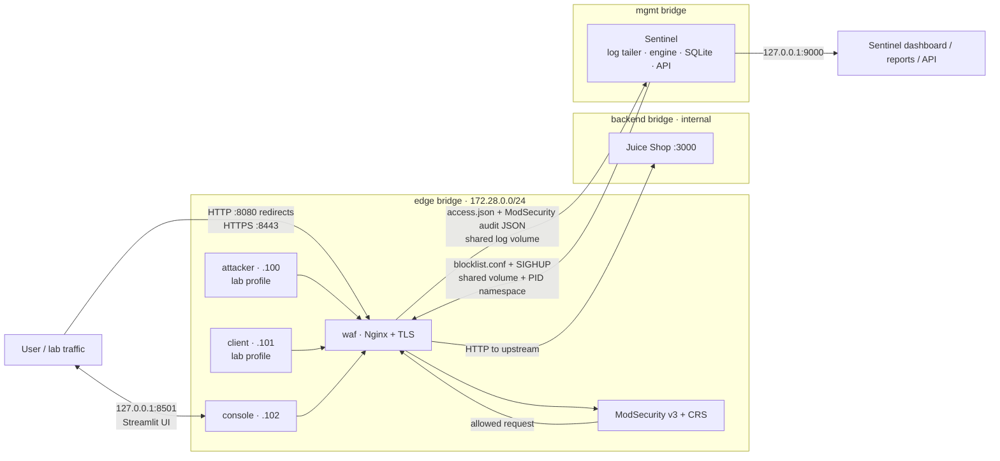

# PS6 – Shield Wall

**ShieldWall** is a local web-application security lab that places a TLS-terminating reverse proxy and web application firewall (WAF) in front of OWASP Juice Shop. It combines Nginx, ModSecurity v3, the OWASP Core Rule Set (CRS), application-specific virtual patches, and Sentinel, a small log-analysis and response service.

The project is designed for the PS6 “Shield Wall” hackathon challenge: protect a deliberately vulnerable application without changing its code, assess common web-attack traffic, preserve legitimate application use, and present security events with MITRE ATT&CK context.

> **Scope and evidence note:** This is a lab implementation, not a production security product. It includes local replay reports, but those reports represent different runs and do not establish a universal security guarantee. In the latest saved post-fix attack replay, 20 of 20 checks were counted as blocked and zero exploits were reported, but the replay's `auto_ban` result was `false`. One counted check was an Nginx HTTP 400 edge rejection, not a ModSecurity block. Also, the current `console/app.py` source has a Python syntax error at line 461; the source must be fixed before a fresh Console container can start successfully.

## Table of contents

- [Problem and objectives](#problem-and-objectives)
- [Features](#features)
- [Architecture](#architecture)
- [Components](#components)
- [Request and event flow](#request-and-event-flow)
- [Supported attack categories](#supported-attack-categories)
- [Rate limiting and automatic bans](#rate-limiting-and-automatic-bans)
- [Protection modes](#protection-modes)
- [Technology stack](#technology-stack)
- [Repository structure](#repository-structure)
- [Prerequisites and setup](#prerequisites-and-setup)
- [Configuration](#configuration)
- [Build, operate, and stop](#build-operate-and-stop)
- [Traffic tests and demonstration](#traffic-tests-and-demonstration)
- [Dashboard, Console, and API](#dashboard-console-and-api)
- [Reports and evidence](#reports-and-evidence)
- [MITRE ATT&CK mapping](#mitre-attck-mapping)
- [Testing and validation](#testing-and-validation)
- [Security considerations](#security-considerations)
- [Known limitations](#known-limitations)
- [Future enhancements](#future-enhancements)
- [Conclusion and team](#conclusion-and-team)

## Problem and objectives

OWASP Juice Shop is intentionally vulnerable. ShieldWall demonstrates a compensating-control approach: put a security boundary in front of the application, inspect requests there, and use resulting security events to drive a limited automated response.

Project objectives:

1. Provide a reproducible Compose-based lab with an isolated vulnerable target.
2. Terminate TLS and inspect inbound HTTP requests before proxying them.
3. Use CRS detections together with narrowly scoped application-specific rules.
4. Demonstrate six attack categories and a separate benign-traffic workload.
5. Apply login rate limits and automatically block sources that accumulate enough signals.
6. Centralize WAF logs in Sentinel and make events, reports, and ATT&CK mappings inspectable.
7. Document the distinction between intended behavior and behavior verified by tests or saved evidence.

## Features

- Nginx reverse proxy with HTTP-to-HTTPS redirection and TLS 1.2/1.3.
- ModSecurity v3 with OWASP CRS 4.7.0, configured for paranoia level 2 by default.
- Request-body inspection for JSON and XML content.
- Three custom virtual-patch rules, honeypot paths, and scoped CRS exclusions.
- Per-IP login and general request rate limits.
- Sentinel's JSON-log tailer, SQLite event store, rule-family classification, and escalating IP bans.
- Sentinel dashboard, presenter view, alert and ATT&CK views, and Prometheus-format metrics.
- Streamlit Attack Console for selecting attack cases, generating benign traffic, and viewing live Sentinel data.
- Separate fixed-IP `attacker` and `client` containers for replay tests.
- Offline Sentinel and Console-logic unit tests.

The features above describe implementation, not blanket effectiveness. Use the saved reports and current test commands to assess what has actually been exercised.

## Architecture



Compose defines three networks:

| Network | Members and purpose |
|---|---|
| `edge` (`172.28.0.0/24`) | WAF, Console, and optional replay clients. The WAF publishes host ports 8080 and 8443. |
| `backend` | `waf` and `juiceshop`; marked `internal: true`, with no host-published Juice Shop port. |
| `mgmt` | Sentinel and Console management access. Sentinel and Console host ports bind to loopback. |

The `attacker` and `client` services use the `lab` Compose profile and are run on demand. The `console` service is in the default Compose set.

## Components

### Nginx reverse proxy

Configured in [waf/nginx.conf.template](waf/nginx.conf.template), Nginx redirects HTTP on port 80 to HTTPS, terminates TLS on port 443, checks Sentinel's generated IP blocklist, applies request limits, and proxies permitted traffic to `juiceshop:3000`. It overwrites incoming `X-Forwarded-For` with the connection source address, removes selected upstream headers, and emits structured access logs.

Nginx can reject requests independently of ModSecurity. The project uses response header values to distinguish common actions:

| Header value | Meaning |
|---|---|
| `blocked-waf` | A request was denied through the WAF error handler, commonly after a ModSecurity deny. |
| `blocked-ip` | Nginx rejected a source found in Sentinel's dynamic blocklist. |
| `rate-limited` | Nginx's rate or connection limit rejected the request, normally with HTTP 429. |

An Nginx parser-level rejection such as HTTP 400 may have no `X-Shield-Action` header and is not a ModSecurity block. The attack replay recognizes one specific encoded-path HTTP 400 response as an edge rejection; this contributes to its blocked count.

### ModSecurity

ModSecurity v3 is loaded as an Nginx module. Its configuration is in `waf/modsec/`. The rule engine is configured from `SHIELD_MODE`; request bodies are inspected, with JSON and XML processors selected by content type. Relevant transaction records are written as JSON audit logs for Sentinel.

### OWASP Core Rule Set

The WAF image downloads CRS version 4.7.0 at build time. CRS rules are loaded after the project's setup and `rules-before/` rules. The default configuration sets paranoia level 2, inbound anomaly threshold 5, and early blocking. These are configuration choices; they do not prove that every attack variant is blocked.

### OWASP Juice Shop

Compose uses the pinned image `bkimminich/juice-shop:v17.1.1`. It is the intentionally vulnerable target and is attached only to the internal `backend` network, where the WAF is its gateway.

### Sentinel detection and response engine

Sentinel is a Python standard-library service with SQLite persistence. It tails the shared Nginx access log and ModSecurity audit log, classifies rule IDs and custom tags, records events and traffic buckets, and serves the dashboard and API.

In blocking mode it applies a ban by atomically writing an Nginx `geo` include file and sending `SIGHUP` to the Nginx master process. Compose places Sentinel in the WAF's PID namespace for this purpose; it does not mount the Docker socket. Sentinel reads the log volume read-only and writes its database to the `sentinel-data` volume.

### Streamlit Attack Console

The Console code is in `console/`. It imports the attack catalog from `lab/tests/attack_replay.py`, offers selectable attack cases and custom requests, can generate repeated benign requests, and polls Sentinel for a live defense view. Its target is configured to the lab WAF; its published port is loopback-only.

**Current source caveat:** `console/app.py` currently contains stray text (`git status`) after a closing parenthesis at line 461. Python syntax compilation fails there. The image build copies the Python file but does not compile it, so a build may succeed while the new Console container fails at startup. An already-running container may be based on an earlier image and does not verify the current source.

### Monitoring dashboard

Sentinel serves a self-contained HTML dashboard at `/` and supporting views at `/present`, `/alerts`, `/attack-layer`, and `/metrics-view`. The views use Sentinel API responses for current mode, event totals, attack classifications, traffic timeline, active bans, triggered rules, and observed ATT&CK techniques. The presenter view can also display replay JSON loaded from `/reports`; it shows “no evidence” when the expected demo artifacts are absent.

### Attack and benign traffic generators

- `lab/tests/attack_replay.py` contains 16 individual payload cases across SQL injection, XSS, path traversal, command injection, scanner User-Agents, and virtual patches. It also runs a 40-attempt login burst and three honeypot probes. The script reports **20 checks**; the brute-force check itself sends multiple requests.
- `lab/tests/benign_replay.py` sends 27 normal application requests, including registration, login, basket operations, and posting a review. Its default pass threshold is 95% not marked blocked by ShieldWall.
- The replay images are built from `lab/Dockerfile` and use fixed edge IPs `.100` and `.101`; they trust the generated lab CA when it exists.

## Request and event flow

```
sequenceDiagram
    participant Client
    participant N as Nginx
    participant W as ModSecurity + CRS
    participant J as Juice Shop
    participant S as Sentinel
    Client->>N: HTTPS request
    N->>N: Check dynamic blocklist
    alt Source already banned
        N-->>Client: 403 blocked-ip
    else Not banned
        N->>W: Inspect request headers, URI, args, and configured body
        alt WAF disruptive rule denies
            W-->>Client: 403 blocked-waf
        else WAF permits request
            N->>N: Apply login/general rate limits
            alt Rate limit exceeded
                N-->>Client: 429 rate-limited
            else Within limit
                N->>J: Proxy request
                J-->>Client: Application response
            end
        end
    end
    N-->>S: access.json; relevant ModSecurity audit records
    S->>S: Classify, persist, count weighted signals
    S->>N: Update shared blocklist and signal Nginx
```

In the current Nginx configuration, the dynamic IP check occurs before ModSecurity processing. The WAF's blocked response and Nginx's rate-limit response are separate handling paths. Sentinel can only classify events represented in the logs it receives.

## Supported attack categories

| Category | Test coverage and configured controls |
|---|---|
| SQL Injection | Login bypass, UNION-style, and boolean probes; primarily CRS SQLi rules (942xxx). |
| Cross-Site Scripting | Search and JSON feedback probes; primarily CRS XSS rules (941xxx). |
| Path Traversal | Encoded traversal, `/ftp` null-byte, and query probes; CRS path-traversal rules (930xxx), Nginx edge parsing, and VPATCH-003. |
| Command Injection | Command-like search parameters; primarily CRS command-injection rules (932xxx). |
| Scanner User-Agent | sqlmap and Nikto User-Agent probes; CRS scanner signatures (913xxx). |
| Login Brute Force | A repeated login burst; Nginx login rate limiting and Sentinel's soft-event/strike logic. |

Additional test cases cover NoSQL operator injection and a B2B order payload through virtual patches, plus decoy paths through the honeypot rule. The scripts exercise representative payloads; they are not an exhaustive security test.

## Rate limiting and automatic bans

Nginx applies limits per client IP:

- Login and password-reset paths: `LOGIN_RATE` (default `5r/m`) with `LOGIN_BURST` (default `5`).
- Other paths: `GENERAL_RATE` (default `50r/s`) with `GENERAL_BURST` (default `200`).
- A per-IP connection limit of 100 is configured in the Nginx template.

Nginx rate-limit rejections use HTTP 429 and the `rate-limited` action. Sentinel combines log-derived signals in a `STRIKE_WINDOW` (default 120 seconds), and in `on` mode bans at `BAN_STRIKES` (default 20 weighted strikes). Documented weights are 1 for a WAF-blocked event, 1 for a rate-limited login, 0.5 for failed login (401), and 0.5 for a rate-limited non-login request. A tagged honeypot event contributes the full threshold and is intended to trigger an immediate ban.

Ban durations escalate by offense using `BAN_STEPS`: 300 seconds, 1,800 seconds, and 86,400 seconds (5 minutes, 30 minutes, and 24 hours). Sentinel sweeps approximately every two seconds, persists bans, updates the shared blocklist, and reloads Nginx. The source allowlist is exempt from auto-banning. These mechanisms are implemented and covered by unit tests, but the latest saved attack replay has `auto_ban: false`; do not treat the replay as proof that the end-to-end auto-ban check passed.

## Protection modes

| Mode | ModSecurity | Nginx rate limiting | Sentinel auto-ban |
|---|---|---|---|
| `on` | Blocking (`SecRuleEngine On`) | Enforced | Enabled |
| `detect` | Detection only (`DetectionOnly`) | Dry-run | Disabled |
| `off` | Disabled (`Off`) | Dry-run | Disabled |

`off` disables ModSecurity inspection, not the Nginx reverse proxy or TLS termination. Detection-only and WAF-off modes do not enforce Nginx rate limits or Sentinel bans. Use `make mode-on`, `make mode-detect`, and `make mode-off` to change mode; these scripts update `.env` and recreate WAF and Sentinel to keep their shared PID namespace consistent.

## Technology stack

| Layer | Implementation |
|---|---|
| Target application | OWASP Juice Shop `v17.1.1` |
| Reverse proxy / TLS | Nginx, TLS 1.2 and 1.3 |
| WAF | ModSecurity v3 with Nginx connector |
| Rules | OWASP CRS `4.7.0`, project SecLang honeypot and virtual-patch rules |
| Runtime / orchestration | Docker Compose, Debian `trixie-slim`, Python `3.12` images |
| Detection and persistence | Python standard library, SQLite |
| Interactive Console | Streamlit `1.40.0`, Requests `2.32.3` |
| Traffic replay | Python, Requests `2.32.3` |
| Reporting | Sentinel Markdown, ATT&CK Navigator JSON, Prometheus text metrics |

CRS and Juice Shop are version-pinned in the project configuration. Debian package versions are not pinned, and the WAF build requires network access to download OS packages and CRS.

## Repository structure

```text
.
├── .env.example
├── docker-compose.yml
├── Makefile
├── README.md
├── certs/
│   └── .gitkeep                 # lab certificates are generated locally and ignored
├── console/
│   ├── Dockerfile
│   ├── app.py                   # Streamlit UI (currently has a syntax error; see above)
│   ├── lab.py                  # catalog, requests, Sentinel client, benign generator
│   └── tests/
│       └── test_lab.py
├── docs/
│   ├── ARCHITECTURE.md
│   ├── ATTACK-MAPPING.md
│   ├── DEMO-SCRIPT.md
│   ├── DESIGN-DECISIONS.md
│   ├── OPERATIONS.md
│   ├── TESTING.md
│   ├── THREAT-MODEL.md
│   └── TUNING.md
├── lab/
│   ├── Dockerfile
│   └── tests/
│       ├── attack_replay.py
│       ├── benign_replay.py
│       └── common.py
├── reports/
│   └── .gitkeep                 # generated JSON/Markdown reports are ignored by Git
├── scripts/
│   ├── demo.sh
│   ├── gen_certs.sh
│   └── set_mode.sh
├── sentinel/
│   ├── Dockerfile
│   ├── sentinel/
│   │   ├── api.py
│   │   ├── attackmap.py
│   │   ├── config.py
│   │   ├── engine.py
│   │   ├── insights.py
│   │   ├── main.py
│   │   ├── nginx_ctl.py
│   │   ├── store.py
│   │   ├── tailer.py
│   │   └── static/
│   │       ├── dashboard.html
│   │       ├── insights.html
│   │       └── presenter.html
│   └── tests/
│       └── test_engine.py
└── waf/
    ├── Dockerfile
    ├── entrypoint.sh
    ├── nginx.conf.template
    ├── snippets/
    │   └── proxy_common.conf
    └── modsec/
        ├── main.conf.template
        ├── modsecurity.conf
        ├── shield-setup.conf
        ├── rules-before/
        │   ├── 00-honeypot.conf
        │   ├── 10-juiceshop-exclusions.conf
        │   └── 20-virtual-patches.conf
        └── rules-after/
            └── 90-after-crs.conf
```

The working checkout may also contain local, Git-ignored reports and generated certificates. Do not commit certificate keys or secrets. `reports/` is mounted read-only into Sentinel for the presenter view; replay containers write their reports to the host `reports/` directory.

## Prerequisites and setup

Use a Linux shell, macOS, or Ubuntu under WSL2. For Windows, the project documentation recommends WSL2 and keeping the checkout in the WSL filesystem. Required tools:

- Docker Engine or Docker Desktop with Compose v2.
- GNU Make.
- OpenSSL for generating the lab CA and server certificate.
- Python 3 for the host-side `make test` target; the Console tests also import `requests`.
- Internet access for the initial image pulls and WAF image build.
- Approximately 2 GB of free disk, as suggested by the project quickstart.
- Host ports 8080, 8443, 9000, and 8501 available by default.

From the repository root:

```bash
# If .env does not already exist, create it from the example.
if [ ! -f .env ]; then cp .env.example .env; fi

# Generate the local lab CA/server certificate, build images, and start defaults.
make up

# Check service status and health.
docker compose ps

# Optional HTTP readiness checks.
curl -fsS http://127.0.0.1:9000/healthz
curl -sS -o /dev/null -w 'Dashboard HTTP %{http_code}\n' http://127.0.0.1:9000/
```

Do not overwrite an existing local `.env` blindly; it may contain local configuration. `make up` invokes `make certs` and then `docker compose up -d --build`. Default services are Juice Shop, WAF, Sentinel, and Console; the attack/client replay services are run on demand. The current Console syntax issue means a freshly started Console may fail even when the other services are healthy.

Open the application with a browser at `https://localhost:8443`. Since the certificate is signed by a private lab CA, browsers will not trust it until that CA is imported locally. For a verified curl request that does not require changing host DNS:

```bash
curl --cacert certs/ca.crt \
  --resolve shield.local:8443:127.0.0.1 \
  https://shield.local:8443/
```

The default dashboard, presenter, and Console URLs are:

- App: `https://localhost:8443`
- Sentinel dashboard: `http://127.0.0.1:9000`
- Presenter view: `http://127.0.0.1:9000/present`
- Attack Console: `http://127.0.0.1:8501`

To inspect startup failures:

```bash
docker compose ps
docker compose logs --tail=100 juiceshop waf sentinel console
```

## Configuration

Compose reads its variable substitutions from `.env`. The checked-in `.env.example` contains these defaults:

| Variable | Default | Purpose |
|---|---:|---|
| `SHIELD_MODE` | `on` | Initial mode: `on`, `detect`, or `off`. |
| `HTTP_PORT` | `8080` | Host port redirected to HTTPS. |
| `HTTPS_PORT` | `8443` | Published WAF HTTPS port. |
| `SENTINEL_PORT` | `9000` | Loopback-published Sentinel API/dashboard port. |
| `CONSOLE_PORT` | `8501` | Loopback-published Console port. |
| `PARANOIA` | `2` | CRS paranoia level (documented range 1–4). |
| `INBOUND_THRESHOLD` | `5` | CRS inbound anomaly threshold. |
| `LOGIN_RATE` | `5r/m` | Login/reset-password rate. |
| `LOGIN_BURST` | `5` | Nginx login burst. |
| `GENERAL_RATE` | `50r/s` | General request rate. |
| `GENERAL_BURST` | `200` | General request burst. |
| `BAN_STRIKES` | `20` | Weighted Sentinel strikes required for a ban. |
| `STRIKE_WINDOW` | `120` | Strike window in seconds. |
| `BAN_STEPS` | `300,1800,86400` | Escalating ban durations in seconds. |
| `ALLOWLIST` | `127.0.0.1,::1,172.28.0.1` | Sentinel sources excluded from auto-ban. |
| `SENTINEL_TOKEN` | empty | Optional token required in `X-Token` for POST requests such as unban. |

Change ports if they conflict with local services. After changing Compose environment values, recreate the affected containers; the operations guide gives the corresponding Compose command. Mode targets handle their own `.env` update and recreation. If `SENTINEL_TOKEN` is set, the current `make unban` recipe does not send `X-Token`, so that target will receive an authorization failure; the Console's unban request does send the configured token.

## Build, operate, and stop

The following are Makefile targets, verified against the current `Makefile`:

| Command | Behavior |
|---|---|
| `make certs` | Runs `scripts/gen_certs.sh`; creates a local lab CA and server certificate if the required files are not already present. |
| `make up` | Generates certificates, builds images, and starts default Compose services in the background. |
| `make down` | Runs `docker compose --profile lab down`; stops and removes project containers and networks while preserving named volumes and generated reports. |
| `make mode-on` | Sets blocking mode and recreates WAF and Sentinel. |
| `make mode-detect` | Sets detection-only mode and recreates WAF and Sentinel. |
| `make mode-off` | Sets ModSecurity-off mode and recreates WAF and Sentinel. |
| `make benign` | Runs the 27-request benign replay in the `client` container. |
| `make attack` | Runs the attack replay with `--expect block`; exits successfully only if all 20 checks are counted blocked. |
| `make demo` | Runs the baseline and protected demo workflow, generates numbered replay reports, then saves alert summary and Navigator layer output. It sends attack traffic to this project’s lab target. |
| `make report` | Fetches `/report.md` and `/api/navigator-layer` into `reports/alert_summary.md` and `reports/attack_navigator_layer.json`. |
| `make unban` | Sends an unauthenticated `POST /api/unban` request to clear all bans; requires no configured Sentinel token. |
| `make fp` | Prints recent blocked events for the fixed benign-client IP `172.28.0.101`; useful after a false positive. |
| `make logs` | Follows WAF and Sentinel logs. For Console logs, use `docker compose logs -f console`. |
| `make test` | Runs the Sentinel and Console-logic offline unit tests. It does not run attack traffic or validate the live WAF. |
| `make clean` | **Destructive:** runs `docker compose --profile lab down -v --remove-orphans` and deletes `reports/*.json` and `reports/*.md`. This removes Compose volumes, including Sentinel data and log/blocklist volumes, as well as local generated reports. |

`make mode-*` changes `.env` as part of its operation. The `make demo` workflow also changes the mode, runs the lab attack replay in off and on modes, and writes report files. Use these commands only when ready to change the local stack or generate traffic.

## Traffic tests and demonstration

### Benign traffic

With the stack up and in blocking mode:

```bash
make mode-on
make benign
```

The replay sends 27 application requests and exits with status 0 when at least 95% are not marked blocked. Use the output and generated `reports/benign.json` result as evidence; an HTTP error from Juice Shop is not necessarily a WAF block, since the script checks ShieldWall action headers.

### Attack replay

Only run this against the local ShieldWall lab:

```bash
make mode-on
make unban
make attack
```

`make attack` uses the isolated attacker container and expects all 20 checks to be counted blocked. Its reported verdict combines action headers with the one special Nginx parser-rejection case described above. Review each status, action, `auto_ban` result, and note in the JSON report; a 20/20 counter alone is not proof every request was blocked by ModSecurity or that auto-banning worked.

### Complete demonstration

```bash
make up
make demo
```

The demo script runs an unprotected attack baseline, switches to blocking mode, clears bans, runs benign traffic, runs the protected attack replay, then fetches the Markdown summary and Navigator layer. It writes these named files:

- `reports/1_attack_baseline_waf_off.json`
- `reports/2_benign_waf_on.json`
- `reports/3_attack_waf_on.json`
- `reports/4_alert_summary.md`
- `reports/5_attack_navigator_layer.json`

The script uses `set -uo pipefail` but not `set -e`; read the output and inspect each artifact rather than assuming any earlier failed step stopped the workflow.

## Dashboard, Console, and API

### Sentinel web views

| URL | View |
|---|---|
| `http://127.0.0.1:9000/` | Live KPIs, attack types, 30-minute traffic timeline, ATT&CK techniques, bans, and recent events. |
| `http://127.0.0.1:9000/present` | Architecture, live counters, category mapping, demo evidence comparison, and requirement scorecard. |
| `http://127.0.0.1:9000/alerts` | Alert summary with attack types, rule IDs, and active bans. |
| `http://127.0.0.1:9000/attack-layer` | Observed ATT&CK techniques and Navigator export information. |
| `http://127.0.0.1:9000/metrics-view` | Dashboard view of the Prometheus-format metrics. |
| `http://127.0.0.1:9000/report.md` | Downloadable Markdown alert summary. |
| `http://127.0.0.1:9000/api/navigator-layer` | ATT&CK Navigator layer JSON. |
| `http://127.0.0.1:9000/metrics` | Prometheus exposition text. |

The dashboard derives values from Sentinel's SQLite database, which is populated from shared WAF logs. It is not a simulated dashboard, though empty charts are expected before traffic has been logged. Event and request totals can differ because they represent different log-derived records and the dashboard's reporting windows/limits.

Other read endpoints include `/api/summary`, `/api/events`, `/api/bans`, `/api/evidence`, and `/healthz`. `POST /api/unban` accepts `{"all":true}` or `{"ip":"..."}`; when configured, Sentinel requires `X-Token`.

### Attack Console

The Console is published at `http://127.0.0.1:8501`. Its intended UI supports attack selection, custom request construction, benign traffic generation, result downloads, an auto-refreshing Sentinel view, and an unban control. The Console's edge IP is fixed to `.102` and is not in the default allowlist.

**It is not currently usable from the checked-out source until the syntax error in `console/app.py:461` is corrected.** The offline Console-logic tests do not import `app.py` and therefore do not detect this failure.

## Reports and evidence

`make report` produces a Markdown alert summary and ATT&CK Navigator JSON from the current Sentinel database. `make demo` additionally saves labeled baseline, benign, and protected replay JSON files. The Markdown report includes recorded event totals, types, ATT&CK/CWE/CAPEC mappings, top rules, and active bans. Navigator technique scores are observed event counts, not severity scores.

The current local checkout contains ignored generated report snapshots. Examples:

- `reports/final_benign_check.json`: 27 of 27 benign requests allowed (100%).
- `reports/verification_after_fix.json`: 20 of 20 attack checks counted blocked, 0 successful exploit checks; its `auto_ban` field is `false`.
- `reports/alert_summary.md`: a separate runtime summary snapshot that records an active ban.

These are not a single synchronized test run: the files were generated at different times. The blocked count includes an Nginx edge HTTP 400 identified by the replay script, and the attack JSON did not confirm the post-run auto-ban probe. Generated reports are Git-ignored by `.gitignore`; a fresh clone contains only `reports/.gitkeep` until tests or demos generate artifacts. Do not present the saved snapshots as proof that all categories, modes, and response paths have been independently validated.

## MITRE ATT&CK mapping

Sentinel classifies CRS rule prefixes and custom rule tags in `sentinel/sentinel/attackmap.py`. The principal mappings requested for PS6 are:

| Technique | Name | Project context |
|---|---|---|
| **T1190** | Exploit Public-Facing Application | SQLi, XSS, traversal, command injection, virtual-patch events. |
| **T1595.002** | Active Scanning: Vulnerability Scanning | Scanner-signature/User-Agent events. |
| **T1110** | Brute Force | Login-rate-limit and failed-login signals. |

Additional mappings include **T1595.003** for honeypot/wordlist probes and **T1059** alongside T1190 for command injection. CWE and CAPEC mappings are also attached to event types where configured. The Navigator JSON currently declares ATT&CK version 16, Navigator 5.1.0, and layer format 4.5; `docs/ATTACK-MAPPING.md` explicitly says to verify framework versions before submission.

## Testing and validation

ShieldWall uses separate validation layers:

1. **Configuration validation:** `docker compose config --quiet` validates Compose rendering. It does not build images or prove services work.
2. **Offline unit tests:** `make test` runs Sentinel engine tests and Console logic tests. On the repository checkout reviewed for this README, all 12 Sentinel tests and all 4 Console logic tests passed. These use synthetic data/fake HTTP service behavior and do not test a live WAF, TLS, Nginx reload, or actual Juice Shop exploit behavior.
3. **Replay tests:** `make benign` and `make attack` exercise a live local stack. Their pass criteria are in the scripts and [docs/TESTING.md](docs/TESTING.md). Do not run these against any non-lab host.
4. **Manual acceptance checks:** [docs/TESTING.md](docs/TESTING.md) documents TLS, redirect, application isolation, replay, logging, and summary checks. The recorded “Observed” fields in that guide remain the place to track fresh acceptance results.

The current latest saved benign and attack reports are summarized under [Reports and evidence](#reports-and-evidence). In addition, `python3 -m py_compile` on the checked-out Python sources fails for `console/app.py` at line 461; passing Console-logic tests therefore does not mean the Streamlit application source builds or runs. Fix and retest that before demonstrating the Console.

## Security considerations

- This repository intentionally deploys a vulnerable application. Keep it as a local lab and do not expose it to untrusted networks.
- In Compose, WAF host ports 8080 and 8443 are published on all host interfaces unless the host/runtime restricts them. The Sentinel and Console ports are explicitly bound to `127.0.0.1`.
- The default allowlist includes the Docker gateway address `172.28.0.1`; host-origin requests may be exempt from auto-ban. Source-IP behavior can differ across Docker platforms.
- The lab certificate generator sets the server private key mode to `0644`; it is unsuitable for production or a shared host. Do not distribute or commit generated private keys.
- Sentinel read endpoints have no authentication; loopback binding limits local exposure, not access by other processes/users on the host. `SENTINEL_TOKEN` protects the unban POST route when configured, but the current Makefile unban target does not send it.
- Sentinel shares the WAF PID namespace and can signal Nginx. This avoids Docker socket access but means a compromised Sentinel could affect the WAF process.
- The backend network is internal, containers drop capabilities where configured, and no Docker socket is mounted.
- A WAF is a compensating control, not a replacement for patching the application or for defense in depth.

## Known limitations

- The Console source has a syntax error at `console/app.py:461`.
- The latest saved attack replay reports `auto_ban: false`, despite a separate summary snapshot listing an active ban. End-to-end auto-ban behavior requires a fresh, directly observed run.
- One attack check is counted blocked when Nginx returns a specific HTTP 400 parser rejection. It is not a ModSecurity denial.
- The saved attack test checks 20 cases, not full attack coverage; honeypot probes run after the brute-force burst and may be masked by an earlier ban in other runs.
- Rate limits and bans are per source IP and can affect users behind shared NAT; distributed low-rate traffic is not addressed.
- Response-body inspection is disabled (`SecResponseBodyAccess Off`), so response-side CRS protections are not active.
- Debian and Nginx/ModSecurity package versions float at build time. Only CRS and the Juice Shop image are version-pinned.
- The ATT&CK mapping version is declared in code but framework versions have not all been confirmed in `docs/ATTACK-MAPPING.md`.
- The replay harness primarily judges decisions using ShieldWall response headers, with one explicit edge-400 exception. This is useful for the lab but is not independent proof of application-layer exploit prevention.
- The current report directory may contain stale or separate run snapshots, and these generated files are ignored by Git.

Further operational notes are in [docs/OPERATIONS.md](docs/OPERATIONS.md), the threat model in [docs/THREAT-MODEL.md](docs/THREAT-MODEL.md), and the tuning workflow in [docs/TUNING.md](docs/TUNING.md).

## Future enhancements

1. Remove the stray text in `console/app.py`, run syntax checks, and verify a clean Console image startup.
2. Re-run the full demo and independently confirm the attacker IP is banned and subsequently rejected by Nginx.
3. Record consistent, timestamped acceptance evidence for TLS, isolation, benign traffic, all attack categories, and reports.
4. Add a dedicated replay assertion for whether each event was blocked by ModSecurity, Nginx rate limiting, the dynamic ban list, or the Nginx parser.
5. Pin the WAF OS package versions and tighten lab private-key permissions.
6. Verify ATT&CK/CWE/CAPEC references against current framework releases and update the documentation.
7. Consider authenticated access for dashboard read endpoints if the service is ever exposed beyond loopback.

## Conclusion and team

ShieldWall combines edge request filtering, traffic replay, log-derived analytics, and a small automated response loop around a vulnerable web application. Its configuration, tests, reports, and limitations are documented so the hackathon review can distinguish implemented behavior from demonstrated results.

**Project:** PS6 – Shield Wall

**Team:** Add the registered team name and member names here before submission.

**Attribution:** The lab uses OWASP Juice Shop (MIT), Nginx, ModSecurity v3, and OWASP CRS (Apache-2.0). Add any required AI-assistant disclosure according to the hackathon rules.

See the [documentation index](docs/) for architecture, operations, test procedures, design decisions, threat model, tuning notes, and the demo script.
