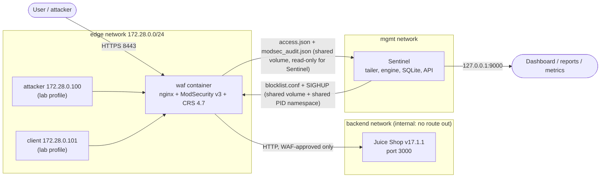
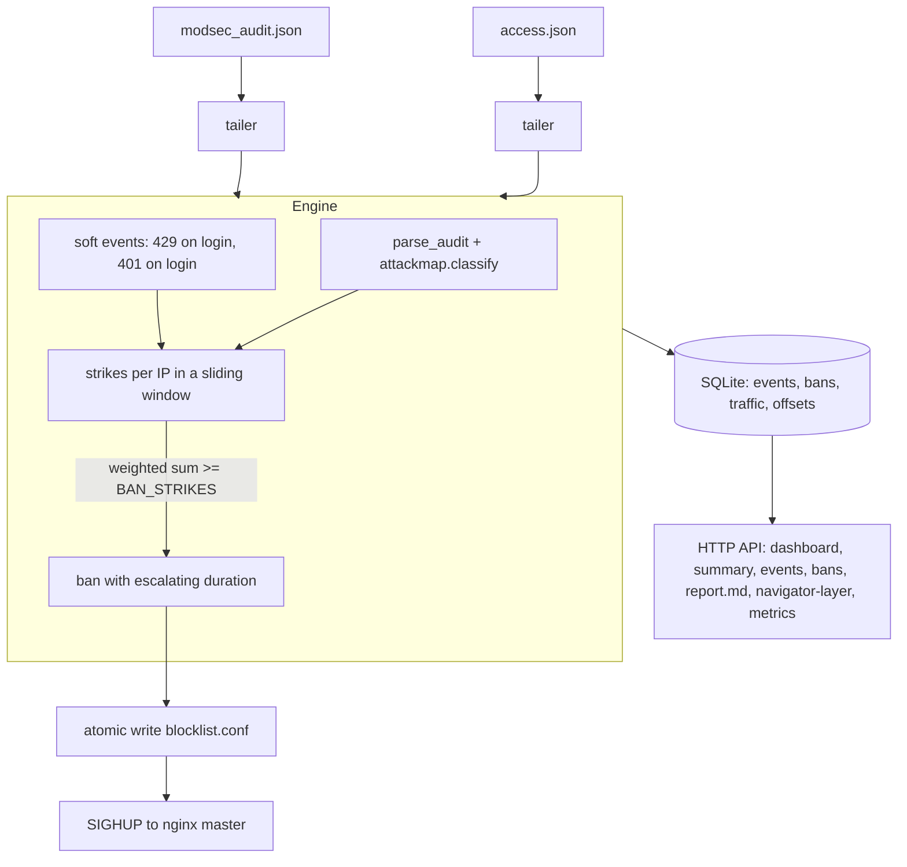

# Architecture

## 1. Goal and constraints

Protect a deliberately vulnerable application (OWASP Juice Shop) that **cannot be patched**, using only controls placed in front of it. The solution must block every request in an attack script, allow at least 95% of a benign script, throttle and auto-block brute force, and produce an alert summary by attack type. Everything runs from one `docker compose` file on a laptop.

## 2. Component view



| Component | Responsibility | Source |
|---|---|---|
| **waf** | TLS termination, HTTP to HTTPS redirect, ModSecurity v3 + CRS inspection, honeypots, virtual patches, rate limiting, dynamic IP blocklist, structured logs | `waf/` |
| **juiceshop** | The vulnerable target. Reachable only from `waf` over the internal `backend` network | `docker-compose.yml` |
| **sentinel** | Parses logs, classifies attacks, counts strikes, bans, pushes blocklist, serves dashboard, report, Navigator layer, Prometheus metrics | `sentinel/` |
| **attacker / client** | Traffic generators with fixed IPs, so a ban hits only the attacker and the benign client is never affected | `lab/` |

## 3. Request lifecycle

```mermaid
sequenceDiagram
    participant X as Client
    participant N as nginx
    participant M as ModSecurity + CRS
    participant J as Juice Shop
    X->>N: HTTPS request
    N->>N: IP in dynamic blocklist? (geo $shield_blocked)
    alt banned
        N-->>X: 403 X-Shield-Action: blocked-ip
    else not banned
        N->>M: inspect headers, URI, args, JSON body
        M->>M: phase 1-2: honeypot, exclusions, virtual patches, CRS rules, anomaly score
        alt score >= threshold or deny rule
            M-->>X: 403 X-Shield-Action: blocked-waf (via nginx @blocked)
        else allowed
            N->>N: limit_req (login zone or general zone)
            alt over limit
                N-->>X: 429 X-Shield-Action: rate-limited
            else within limit
                N->>J: proxy_pass (X-Forwarded-For overwritten)
                J-->>X: response
            end
        end
    end
    N-)N: write access.json line; ModSecurity writes audit JSON for relevant transactions
```

Notes on ordering:

* The ban check sits in nginx's server-rewrite phase, so a banned source is rejected **before** any WAF rule runs. That keeps the cost of a flood low.
* ModSecurity inspects before the proxy hop. Requests blocked by the WAF are not expected to consume rate-limit budget; rate limiting applies to requests the WAF let through.
* The `@blocked` and `@ratelimited` locations return a small JSON body with the request ID and a machine-readable `X-Shield-Action` header. The test scripts and Sentinel both rely on that header (`blocked-waf`, `blocked-ip`, `rate-limited`).

## 4. Rule evaluation order (`waf/modsec/main.conf.template`)

1. `SecRuleEngine` set from `SHIELD_MODE` (`On`, `DetectionOnly`, `Off`).
2. `modsecurity.conf`: body inspection (JSON and XML processors, so API payloads are inspected key by key), JSON audit log.
3. CRS `crs-setup.conf.example`, then a `SecAction` that sets paranoia level, anomaly threshold and early blocking from the environment.
4. `shield-setup.conf`: allowed HTTP methods and content types for a JSON REST API + SPA.
5. **`rules-before/`**: `00-honeypot` (instant deny), `10-juiceshop-exclusions` (scoped false-positive tuning), `20-virtual-patches` (app-specific denies).
6. **CRS rules** (`/opt/crs/rules/*.conf`).
7. `rules-after/`: reserved for post-CRS logic.

Custom rules run *before* CRS so that a honeypot or virtual patch denies immediately, and so tuning exclusions are in place before CRS evaluates the request.

### Scoring in plain terms

CRS adds points per matched rule (CRITICAL 5, ERROR 4, WARNING 3, NOTICE 2) and blocks when the inbound total reaches `INBOUND_THRESHOLD` (5). One critical hit, or two warnings, blocks. Paranoia level 2 (`PARANOIA=2`) enables a broader rule set than the default level 1 at the cost of more tuning. `early_blocking=1` lets a request be blocked after phase 1 if the score is already high enough.

## 5. Sentinel internals



**Strike weights**

| Signal | Weight | Source |
|---|---:|---|
| WAF-blocked request (403) | 1.0 | audit log |
| Honeypot hit | `BAN_STRIKES` (instant ban) | audit log, tag `shieldwall/honeypot` |
| Rate-limited login attempt (429) | 1.0 | access log |
| Failed login (401) | 0.5 | access log |
| Rate-limited non-login request | 0.5 | access log |

A ban happens when weighted strikes inside `STRIKE_WINDOW` (120 s) reach `BAN_STRIKES` (20). The duration follows `BAN_STEPS` by offense count: 5 min, then 30 min, then 24 h. Bans are persisted, survive restarts, and expire in a 2-second sweep.

**Classification.** `attackmap.py` maps CRS rule-file prefixes (`942` is SQLi, `941` XSS, `930` path traversal, `932` command injection, `913` scanners ...) and our own rule tags to an attack type, then to ATT&CK, CWE and CAPEC. Evaluation rules (`949`, `959`, `980`, `901`, `905`) are ignored as attacks because they only report the score.

**Robustness.** The tailer persists file offsets and inode, so restarts neither lose nor double-count events and log rotation is handled. A malformed line is logged and skipped; it cannot stop the pipeline. The blocklist is written to a temp file and swapped atomically so nginx never reads a partial file. Events from soft signals are capped at about one per second per source and type to protect the database during a flood.

**How Sentinel reloads nginx without the Docker socket.** `sentinel` uses `pid: "service:waf"`, which puts it in the WAF container's PID namespace. It finds the `nginx: master process` in `/proc` and sends `SIGHUP`, nginx's graceful reload. This avoids mounting `/var/run/docker.sock`, which would give the analytics container root-equivalent control of the host.

## 6. Networks and exposure

| Network | Type | Members | Purpose |
|---|---|---|---|
| `edge` 172.28.0.0/24 | bridge, fixed subnet | waf (alias `shield.local`), attacker `.100`, client `.101` | Only network with published ports |
| `backend` | bridge, `internal: true` | waf, juiceshop | The vulnerable app has no route in or out except via the WAF |
| `mgmt` | bridge | sentinel | Sentinel API bound to `127.0.0.1:9000` on the host |

Published ports: `8080` (redirect only) and `8443` (HTTPS) on the host, `127.0.0.1:9000` for the dashboard. Juice Shop has no published port.

## 7. Container hardening

* waf: `cap_drop: ALL` with only the capabilities nginx needs (`NET_BIND_SERVICE`, `SETUID`, `SETGID`, `CHOWN`, `DAC_OVERRIDE`), `no-new-privileges`, TLS certs mounted read-only.
* juiceshop: `no-new-privileges`, image pinned to a version tag.
* sentinel: log volume mounted read-only; writes only to its data volume and the blocklist volume.
* nginx: `server_tokens off`, `Server` header removed, `X-Powered-By` stripped, HSTS and other security headers added, request size and timeouts limited against slow-request abuse.

## 8. Data model (SQLite, `/data/sentinel.db`)

| Table | Purpose |
|---|---|
| `events` | One row per attack event: time, IP, method, URI, user agent, status, rule IDs, attack type, ATT&CK techniques, score, action |
| `bans` | Source IP, since, until, offense count, reason, active flag |
| `traffic` | Per-minute totals and blocked counts for the dashboard timeline |
| `offsets` | Log tail position per file (inode, offset) |

## 9. Observability outputs

| Endpoint | Output |
|---|---|
| `/` | Dashboard (KPIs, attack types, 30-minute timeline, ATT&CK chips, bans, recent events) |
| `/report.md` | Alert summary by attack type with ATT&CK, CWE, CAPEC and top rule IDs |
| `/api/navigator-layer` | ATT&CK Navigator layer JSON of techniques seen |
| `/metrics` | Prometheus text format |
| `/api/summary`, `/api/events`, `/api/bans` | Raw JSON |
