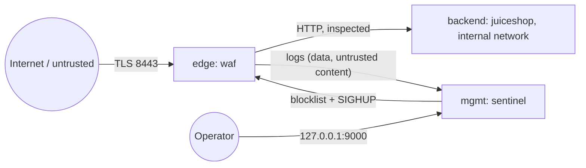

# Threat model

## Assets
* The vulnerable web application and its data.
* Availability of the application for legitimate users.
* Integrity of ShieldWall itself: WAF rules, blocklist, logs, dashboard.

## Adversary
An unauthenticated remote attacker on the same network as the edge, using common tooling (sqlmap, Nikto, ffuf, curl, Hydra-style credential guessing). Out of scope: attackers with host or Docker access, supply-chain attacks on upstream images, volumetric DDoS.

## Trust boundaries

Log content is attacker-controlled (URIs, user agents). Sentinel therefore treats every field as data: it parses JSON, validates IP addresses before writing them to the blocklist (`ipaddress.ip_address`), and the dashboard escapes every field before rendering.

## What ShieldWall mitigates

| Threat | Control | ATT&CK |
|---|---|---|
| SQL injection (CWE-89) | CRS 942xxx, JSON body inspection | T1190 |
| Cross-site scripting (CWE-79) | CRS 941xxx | T1190 |
| Path traversal (CWE-22) | CRS 930xxx, VPATCH-003 | T1190 |
| OS command injection (CWE-78) | CRS 932xxx | T1190, T1059 |
| NoSQL / code injection (CWE-943, CWE-94) | CRS 933/934, VPATCH-001, VPATCH-002 | T1190 |
| Scanner tools | CRS 913xxx, honeypot | T1595.002, T1595.003 |
| Credential brute force (CWE-307) | `limit_req` on login + Sentinel ban | T1110 |
| Slow or oversized requests | body and header limits and timeouts | T1498 (partial) |
| Direct access to the app | `internal` backend network | T1190 |
| Cleartext transport | TLS 1.2/1.3 only, HSTS | T1040 (indirect) |

## Residual risk and known gaps

| Gap | Impact | Mitigation path |
|---|---|---|
| A WAF is a compensating control. The underlying bugs still exist. | A bypass would reach the vulnerable app. | Patch the app; keep virtual patches only until then. |
| Response body inspection is off (`SecResponseBodyAccess Off`). | CRS outbound data-leak rules cannot fire; the outbound threshold in `main.conf.template` has no effect. | Enable response inspection once memory and latency are measured. |
| Rate limits and bans are per source IP. | Distributed attackers or shared NAT. | Add an upstream CDN or reputation feed; add per-account lockout in the app. |
| Allowlist includes `172.28.0.1`, the Docker gateway. | Traffic that reaches the stack from the host through published ports is never auto-banned (convenient for the presenter, not for production). | Remove it from `ALLOWLIST` outside the demo. On Docker Desktop, host traffic may appear from a different address. |
| Dashboard read endpoints have no authentication. | Anyone with localhost access sees alerts. | Bound to `127.0.0.1`; set `SENTINEL_TOKEN` to protect the POST unban route; add a reverse-proxy login for remote use. |
| Lab certificate key is `chmod 644`. | Readable by any local user. | Lab only. Use a secrets store and `600` permissions in production. |
| Sentinel shares the WAF PID namespace. | A compromised Sentinel can see and signal nginx processes. | Accepted in exchange for avoiding `docker.sock`. Sentinel has no inbound exposure except the loopback API. |
| `mgmt` network is not `internal`. | Sentinel could make outbound connections. | Sentinel makes none; make it internal if the port is exposed another way. |
| ATT&CK Navigator layer pins a version number in code. | Version drift. | Confirm against the current ATT&CK release before submission (the organizers' checklist asks for this). |
| Test traffic uses an `X-Shield-Action` response header to judge blocks. | The harness trusts ShieldWall's own header. | Judges can also verify by status code and body; see TESTING.md. |
